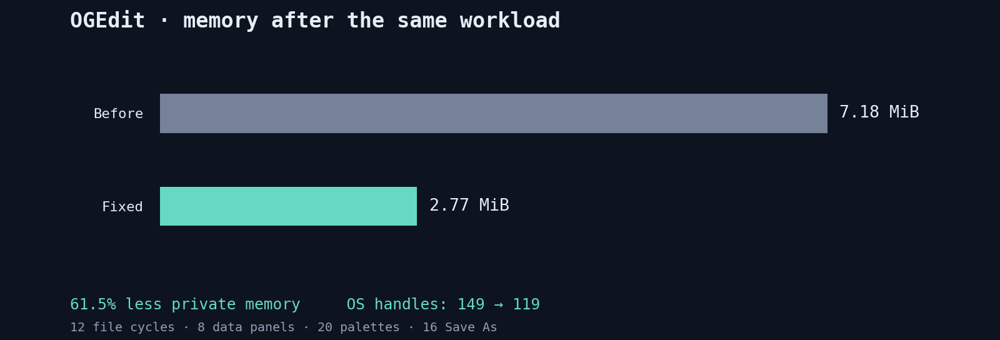

# Memory safety and stress audit

Historical audit before the later upstream integration and OGEdit 2.0.0 version bump. The hashes, versions and measurements below identify those tested snapshots; they are not measurements of the published 2.0.0 binary.

Reviewed on 2026-10-17, after the legacy-fork audit. This audit covers the current OGEdit working tree, including the six modernization features and the later file-picker fixes. It is separate from the historical Microsoft Edit versus OGEdit comparison in [the legacy audit](legacy-audit.md).

The work combines source review, deterministic reference-model tests, ownership/lifetime checks, AddressSanitizer, and aggressive interaction with the real terminal executable through a browser harness. The findings below identify concrete defects or unsafe contracts that were corrected. They do not establish that arbitrary future input is failure-proof. The final validation and measured comparison below distinguish observed results from remaining coverage limits.

Detailed evidence and implementation notes:

- [Allocator, gap-buffer, helper and platform review](memory-unsafe-review.md).
- [Buffer, Unicode, syntax and ICU review](memory-buffer-review.md).
- [TUI, workbench, worker and resource-lifetime review](memory-lifecycle-review.md).

## Confirmed issues and corrections

The numbered rows are an issue ledger, not a count of independently reproduced browser crashes. Some defects were established by a safe API violating its required memory contract; others were reproduced by deterministic tests or resource-ownership checks. Browser evidence belongs in its own section below.

| ID | Defect and consequence | Correction | Regression / implementation evidence |
| --- | --- | --- | --- |
| M01 | Arena capacity rounding, typed-slice multiplication and allocation-end arithmetic could overflow. Optimized code could expose a mutable slice larger than its backing allocation. | Check rounding and offsets, use `Layout::array`, and reject byte lengths beyond `isize::MAX` before pointer arithmetic. | Impossible-size rejection preserves the watermark and existing bytes; [allocator review](memory-unsafe-review.md). |
| M02 | Arena alignment rounded the offset without accounting for the actual base address. Empty-arena zero-sized requests also returned a pointer with insufficient alignment. | Align the actual address and provide an appropriately aligned dangling pointer for zero-sized layouts. | Shifted-base and highly aligned zero-sized regression cases in [release.rs](../src/arena/release.rs). |
| M03 | Arena `grow` and `shrink` incorrectly assumed the new alignment could not increase, contrary to Rust's allocator contract. | Reuse storage only when its address satisfies the new alignment; otherwise allocate and copy. Non-tail shrink retains valid capacity instead of asserting. | Alignment increase, preserved-prefix and zero-filled-growth tests. |
| M04 | Production scratch arenas were process-global mutable state, while library tests used thread-local pools. Concurrent safe callers could race on allocation offsets. | Use thread-local scratch pools in every build. | Eight concurrent workers fill and inspect independent sentinel allocations; [scratch.rs](../src/arena/scratch.rs). |
| M05 | Scratch borrow-order checks disappeared in release; reinitialization could replace live backing memory. Lifetime-erased delegates could survive their pool or be extracted through a public enum. | Retain runtime scope checks, reject reinitialization with live scopes, hide delegates, and give each scope an `Rc` owner of its backing allocator. Remove lifetime transmutation. | Nested resets, invalid older-scope use, live reinitialization rejection, and deliberate reverse TLS-destructor ordering. |
| M06 | Oversized gap requests overflowed spare-space rounding, potentially reducing a gap and underflowing following operations. Heap expansion also did not expose a recoverable reservation failure. | Bound saturating rounding by reserved capacity; use `try_reserve_exact` before resizing heap storage. | Maximum-size request, full-capacity selection replacement, and 50,000 byte-oracle edits across heap and virtual-memory buffers; [gap_buffer.rs](../src/buffer/gap_buffer.rs). |
| M07 | A helper converted uninitialized bytes into `&mut [u8]` before calling safe `Read::read`. Readers may inspect every destination byte, and cannot be trusted to report a valid length for later unsafe code. | Initialize the entire destination before calling the reader and reject counts beyond its length. | Custom inspecting and invalid-count readers in [helpers.rs](../src/helpers.rs). |
| M08 | Unicode repetition, inclusive/exclusive range adjustment, and vector replacement lengths could wrap in release builds. | Check arithmetic before mutation; retain saturating/clamped vector-range semantics. | Oversized Unicode repeat, maximum inclusive bounds and a maximum-length zero-sized-element vector. |
| M09 | Windows debug virtual-memory address generation used an unsynchronized mutable static. Exhausting or colliding with a debug hint also caused artificial allocation failures. | Atomic address generation; retry failed hints with OS-selected placement. | Source review plus concurrent allocator stress; [windows.rs](../src/sys/windows.rs). |
| M10 | Windows console-control and Unix resize-signal callbacks wrote ordinary booleans concurrently with UI reads. | Use atomic flags; consume Unix resize notifications with an atomic swap. | Source review and platform compile coverage; browser resize/exit evidence is recorded separately. |
| M11 | Windows UTF-16 conversion obtained its writable capacity pointer from an empty string, while the Unix ICU symbol helper dereferenced a raw C-string pointer through a safe API. | Use `Vec::spare_capacity_mut` for native output; mark the raw-pointer helper unsafe with an explicit validity, UTF-8 and arena-lifetime contract. | [Platform boundary review](memory-unsafe-review.md); Unicode/native initialization regressions exercise the surrounding paths. |
| M12 | Moving a `TextBuffer` after starting native search left ICU `UText` callbacks pointing at its former address. Loaded-buffer replacement also needed to retire old providers before storage changed. | Keep the underlying gap buffer in a stable allocation and close native search objects before replacing or dropping its storage; close regex before its provider. | Repeated moves, vector reallocations, reloads, edits, undo and destruction; [buffer/ICU review](memory-buffer-review.md). |
| M13 | ICU initialization/catalog state and mutable collator/case-map handles were shared through unsynchronized globals. | Initialize immutable tables once with `OnceLock`; keep mutable native services per thread and close them at thread exit. | Sixteen concurrent initialization, comparison and Unicode-folding workers. |
| M14 | Native regex setup could fail after allocation without closing the allocated handle. | Close non-null regex handles on every later setup error. | 512 valid construction/destruction iterations with three invalid patterns per iteration. |
| M15 | ICU extension storage was exposed as Rust cache references before all `DoubleCache` fields were explicitly initialized. | Initialize caches, arrays and the MRU boolean before creating references, including cloned providers. | Native provider boundary and lifecycle stress in [icu.rs](../src/icu.rs). |
| M16 | Backward native search skipped arbitrary runs of UTF-8 continuation bytes, including invalid sequences, which could move beyond the requested offset and underflow indexing. | Align only within a validated UTF-8 sequence; malformed bytes remain replacement characters. | Every byte offset in both directions through valid Unicode, long malformed runs and cache-boundary crossings. |
| M17 | Native search chunks were keyed by a generation that undo/new branches could reuse. Refreshing at EOF could also retain an old chunk. | Explicitly invalidate native chunks whenever search text is refreshed, including empty and EOF cases. | Undo-branch regression and repeated edit/undo search cycles. |
| M18 | Retrying an expanding native Unicode fold retained the previous buffer-overflow status, so the retry could fail and fall back to incomplete ASCII folding. | Clear the native error status before retrying. | Repeated expansion-heavy U+0390 case folding. |
| M19 | Tabs wider than narrow wrapped viewports exceeded valid columns; moving a word suffix containing a wide tab could still overflow its next row. | Clip visual tab width while preserving logical tab stops, and hard-wrap suffixes that remain too wide. Apply the same rules in look-ahead. | Widths 2–8 crossed with tab stops 1–8, including subsequent resize and undo/redo. |
| M20 | Wrapping look-ahead did not advance its independent byte offset, allowing repeated counting of the last glyph at EOF and a phantom wrapped row. | Track look-ahead progress separately from the requested cursor position. | Deterministic transaction oracle found and now covers the failing sequence. |
| M21 | Disabling wrap at a line start could retain a wrapped-row coordinate. Undo restored visual counts from an obsolete viewport/tab layout, and ambiguous wrap anchors produced incorrect edited-line height deltas. | Clear wrapped coordinates on disable, retain history layout settings and reflow when they change, measure from logical-line origins, and restore wrapped undo cursors from a fresh measurement. | Seeded edits, wrap/tab/viewport changes, bounds checks and complete undo/redo walks. |
| M22 | Unicode-width configuration was a mutable global accessed by a safe setter and concurrent measurement. | Store a clamped one/two-cell width atomically. | Source review plus concurrent Unicode/editor tests; [measurement.rs](../src/unicode/measurement.rs). |
| M23 | TUI cached editors were never marked unseen at the next frame, so closed documents and removed fields stayed strongly referenced. | Reset marks each frame and evict unseen entries after adopting the new tree. | Removed-field ownership test and repeated frame replacements using `Weak` references; [TUI review](memory-lifecycle-review.md). |
| M24 | Arena textarea nodes borrowed buffers whose only strong owner could be replaced in a cache slot. The previous layout tree could then contain dangling references. | Retain a matching vector of buffer owners for each live arena tree; release it only after that tree is reset. | 200 replace/remove cycles prove the previous tree stays valid and retired buffers expire. |
| M25 | Closing or replacing workbench panels retained source documents, data views, drafts, search snapshots and diff allocations. | Release heavy resources on close and unrelated transitions; retain only parent/cell-edit state needed for an active operation, then clear pending snapshots. | `Weak` ownership and zero-capacity assertions in the panel-close regression. |
| M26 | Filesystem notifications used an unbounded channel and drain loop, so an event storm could grow memory or starve input/rendering. | Nonblocking 256-event queue, overflow flag, bounded drain and metadata reconciliation after overflow. | 20,000 injected events still report a watched change and release registrations on unwatch. |
| M27 | Workspace search inserted every visited disk path into its deduplication set, even when nothing matched. | Retain only the open-buffer paths needed to give unsaved content precedence over disk reads. | Search source review and cancellation/snapshot tests; [workspace_search.rs](../src/bin/edit/workspace_search.rs). |
| M28 | Cancelling a search/index task did not bound detached workers while filesystem calls stalled. Repeated replacements could accumulate threads and captured state. | Two permits shared by search/discovery workers; exhaustion returns a retryable error, and exit/spawn failure releases permits. | Third-worker rejection, permit reuse and 48 repeated search cancellations. |
| M29 | File discovery limited item count but not aggregate path storage, permitting unexpectedly large indexes for long paths. | Stop at the existing 200,000-item cap or a conservative 64 MiB candidate-storage budget. | Accounting/source review and worker stress; the budget is not a process-memory ceiling. |
| M30 | Fuzzy scoring allocated a quadratic query/target matrix without a work budget; long pasted input could exhaust the arena. | Checked matrix sizing, 262,144-cell limit, linear subsequence/KMP fallback, and a 16 KiB fuzzy-query limit. Exact-path activation remains independent. | 40,001-character Unicode target, bounded result allocation and oversized-query rejection. |
| M31 | Expanding Unicode folds changed fuzzy string indices, shifting highlights away from original source characters. | Route expanding folds through the position-preserving fallback; use bounded per-character ICU fold keys so final sigma, long s and micro-sign equivalences survive that fallback. | `Straße`/uppercase sharp-S tests check original source positions; `expanding_folds_preserve_icu_equivalences_in_linear_fallback` covers both matching modes. |
| M32 | Repeated Save As operations registered the new path without releasing the previous file/directory watch. | Transfer the watch after a successful save; a failed save preserves the old path and registration. | Thirty-two successful directory changes interleaved with failed saves retain exactly one file and one directory registration; [save_as_and_watch](../src/bin/edit/draw_filepicker.rs). |
| M33 | Recovered abandoned sessions kept lease handles after their final snapshot was discarded; empty abandoned sessions could also retain handles unnecessarily. | Track lease ownership by session and release it once the session no longer needs recovery protection. Preserve damaged snapshots and live sessions. | Thirty-two abandoned sessions are discarded one by one and owned lease count falls to zero; [recovery.rs](../src/bin/edit/recovery.rs). |
| M34 | Empty-session cleanup dropped the exclusive lease before deleting the directory. Another startup could acquire an already-open lease, race removal, and disable recovery when directory enumeration returned `NotFound`. | Hold the exclusive lease through removal; collection treats a directory or entry that disappeared during this handoff as completed cleanup, while retaining real errors. | `concurrently_opened_stale_lease_does_not_disable_recovery` deterministically opens a contender's lease, discards the session elsewhere, resumes collection, then proves fresh unsaved bytes remain recoverable. Final execution result belongs in the validation ledger. |

## Regression and stress coverage

The coverage below describes what the tests in the working tree exercise. It does not substitute for the final execution ledger.

| Layer | Cases exercised | Scale / oracle |
| --- | --- | --- |
| Allocation primitives | Overflow, alignment, zero-sized layouts, grow/shrink, preserved neighbors, nested resets and TLS lifetime | 16,384 mixed allocations, 1,000 nested scratch resets, eight concurrent workers, explicit sentinel and ownership checks. |
| Gap storage | Insert/delete/replace, arbitrary bytes, gap movement/growth, clear, out-of-range reads and capacity rejection | 50,000 deterministic operations split between heap and virtual-memory backing, independently compared with `Vec<u8>` after each step. |
| Editor transactions | Unicode, malformed bytes, CRLF/LF, tabs, multi-selection overlap/reversal/duplicates, extreme offsets, wrap/viewport/tab changes, undo/redo and redo-branch replacement | Eight short seeds × 400 operations plus 128 long seeds × 1,000 operations: 131,200 generated edits before the final undo/redo walks. Failures report seed/step/layout; `OGEDIT_STRESS_TRACE=1` adds a detailed trace. |
| Malformed text and syntax | Navigation, replacement, rendering/highlighting, undo/redo, repeated revisions and viewport churn | 256 malformed-byte documents; syntax checkpoint count and byte-budget assertions, including dropping caches for an empty revision. |
| Native ICU | Provider moves/reloads, cached byte/UTF-16 boundaries, malformed UTF-8, errors, expanding folds and thread exit | 128 buffer/search lifecycles, 512 regex construction/error iterations and sixteen concurrent service users. |
| UI ownership | Frame retirement, disappearing editlines and closed/replaced workbench panels | `Weak` references prove destruction rather than inferring it from allocator RSS; diff capacity is checked directly. |
| Background resources | Watch floods, discovery/search cancellation, worker saturation, large fuzzy input, repeated Save As | 20,000 watcher events, 48 cancelled searches, shared two-worker cap, long Unicode matching and 32 watch transfers. |
| Recovery | Active-instance isolation, exact recovery bytes, corruption preservation, abandoned lease release and concurrent cleanup | 32 abandoned sessions with per-discard handle ownership assertions; deterministic stale-opened-lease interleaving followed by checkpoint/recovery of fresh bytes. |

Useful deterministic reproduction commands:

```powershell
cargo test --locked --lib -- --include-ignored
cargo test --locked --bin ogedit -- --include-ignored
cargo test --locked --lib arena::
cargo test --locked --lib buffer::gap_buffer::
cargo test --locked --lib helpers::tests::
cargo test --locked --lib stress_randomized_transactions_long -- --ignored
```

Release-mode tests are necessary because several historical failures depended on unchecked arithmetic or disabled debug guards. The final execution ledger must include the exact optimized and sanitizer commands used, including any target-directory, environment and instrumentation flags.

## Browser-only manual stress

The browser harness hosts the actual Windows terminal executable through ConPTY and xterm. It uses isolated fixtures and `OGEDIT_DATA_DIR` values; it is not a mock editor. Native desktop/computer automation is excluded under the user's instruction. OS-native file-picker interaction cannot be counted as browser QA merely because its launch button was exercised.

The instrumented browser executable completed the matched workload plus five extra churn rounds: **42 large-document open/close cycles, 28 CSV/JSON panel visits, 120 file-palette cycles, and 16 Save As operations**. Each scripted step waited for the actual terminal title/status before continuing. Two early baseline driver runs were excluded: the driver originally accepted a command label as a modal title and used too short a deadline for background browser rendering. The final driver requires the modal border/title and allows delayed browser output; those were harness corrections, not application fixes.

| Observed scenario | Result |
| --- | --- |
| Six approximately 2 MiB files, repeatedly opened and closed | Returned to the original small file after every close. |
| CSV with 10,000 rows / JSONC with 3,000 objects | Data panels opened, closed, and relinquished their document state; repeated churn completed. |
| File palette open/query/cancel | Repeated discovery/cancellation returned to editing; bounded worker tests additionally cover stalled-worker saturation. |
| Sixteen Save As operations into distinct directories | Each file saved under the expected name; closing the final file and reopening the original returned to the same visible state as startup. |
| Quoted path with mixed `/` and `\` separators into a malformed-byte file | Correct file opened, with its parent folder and filename reflected by Open File; no native desktop automation. |
| All byte values repeated in an 8 KiB malformed file | Navigation to both ends and literal forward/backward search completed without a sanitizer diagnostic. |
| Unicode, combining marks, Hebrew, emoji, CRLF and tabs | Pasted 100 lines in a narrow terminal and ran 12 resize/Undo/Redo cycles between 40×12 and 140×50; final Undo restored the source. |
| Alt-click multiple cursors | Inserting `X` produced `Xalpha`, `Xbeta`, `Xgamma`; no initial character was replaced, and Undo restored all three lines. |
| Long wrapped line | Pasted 199 ASCII characters, an emoji and 100,000 further characters; rendering and replacement with a short line completed. |
| 17,000-character fuzzy query | Displayed the 16 KiB limit, stayed editable, and cleared/cancelled back to the source. |

Local browser transcripts are retained in `target/memory-audit/asan-browser-{workload,edges,churn}.txt`. The final optimized executable is exercised and measured separately below. The ASAN browser binary preceded the last recovery-cleanup race refinement and Unicode-equivalence refinement; the **final-source ASAN suite includes both**, and the final optimized browser run uses both. This distinguishes the precise coverage rather than treating different binaries as identical.

External-change/reload/encoding cases already exercised in the [legacy browser audit](legacy-audit.md#browser-only-manual-qa) remain separate evidence. Native picker interaction, crash termination/restart, remote filesystem stalls and every possible macro/data edit were not all repeated in this browser run; the focused regression suites cover the named invariants without claiming exhaustive GUI coverage.

## Measured before/after resource comparison

The comparison uses the **previous installed build from immediately before the memory audit**, not the historical OGEdit fork baseline. Both optimized executables ran in isolated profiles with a 100×30 terminal, beginning and ending with only `small.txt` visible. The matched workload was 12 large-file open/close cycles, eight data panels, 20 file palettes, and 16 Save As operations into distinct directories. Both profiles began without saved settings.

- Before SHA-256: `F632F6FB834AADF28B3494538721565229E97BA53DB05AD32B739BDAA2B2A0C2` (PID 99036, generation 7).
- Fixed SHA-256: `0F1954699EDCC99150BF9FFEE5D2585E13B36BAEC2FF3C713540B55544357BE2` (PID 74024, generation 13).



| Metric | Before | Fixed |
| --- | ---: | ---: |
| Private committed memory at startup | 2.01 MiB | 2.01 MiB |
| Sampled peak private memory during matched run | 14.21 MiB | 10.83 MiB |
| Private memory after closing/settling | **7.18 MiB** | **2.77 MiB** |
| Working set after closing/settling | 14.91 MiB | 11.43 MiB |
| OS handles at startup | 115 | 115 |
| OS handles after closing/settling | **149** | **119** |
| Threads after matched workload settled | 3 | 3 |

The fixed build used **61.5% less settled private memory** in the matched run. It then passed five additional churn rounds in the **same process** (30 more large documents, 20 more data panels, 100 more palettes). Private memory returned to 2.77 MiB at the end of the rounds and ranged around **2.77–2.84 MiB** during the following 71 seconds; handles remained **119**. Temporary working allocations reached a sampled 12.02 MiB during those extra rounds. Idle worker/thread-pool activity varied from three to five threads. This is bounded reuse/warm-up in the observed run, not proof of zero possible leaks.

Sampling requested an interval of 0.5 seconds; real intervals varied with host scheduling. Startup and settled comparisons use ten-sample medians. The before run has 14 explicitly settled samples over 6.95 seconds; the matched fixed snapshot has 40 over 24.88 seconds. Whole-run sampled peaks include any early operations that overlapped the manually set `before-warm` phase label. Aborted driver runs/PIDs are excluded. Private memory measures committed private pages; working set is resident memory. **Reserved virtual address space was not measured**: psutil's Windows `vms` is commit/pagefile accounting, and its original misleading CSV column name was corrected to `platform_vms`.

Reproducible evidence:

- [Saved measurement summary and executable identity](memory-measurements.json).
- [Read-only sampler](../tools/sample_process_memory.py) and [summary tool](../tools/summarize_process_memory.py).
- Raw local samples: `target/memory-audit/metrics.csv`; frozen matched summary: `matched-comparison.json`; whole run plus repeated rounds: `final-comparison.json`.
- Browser terminal transcripts: `release-browser-workload.txt`, `release-browser-churn.txt`, `release-browser-final.txt` in that directory. The final release exited normally through Ctrl+Q after completion.

ASAN samples are intentionally excluded from the release memory comparison because instrumentation and quarantine have substantial memory overhead.

## Final validation ledger

The final source includes the recovery-concurrency and Unicode fallback refinements. Earlier focused-review totals are checkpoints. All paths below are workspace-relative logs retained under `target/memory-audit/`.

| Check | Final result | Command / evidence |
| --- | --- | --- |
| Debug library + binary tests, including ignored stress/ICU tests | **127 + 107 pass** | `cargo test --locked --all-features --lib --bins -- --include-ignored`; `debug-tests.log`. |
| Optimized library + binary tests | **127 + 107 pass** | Same command with `--release`; `release-tests.log`. |
| AddressSanitizer runtime control / detection probe | **Pass** | Clean probe exits zero; intentional heap write beyond a 4-byte allocation is diagnosed as heap-buffer-overflow. `asan-probe.*`, `asan-redzone.*`. |
| AddressSanitizer library + binary tests | **127 + 107 pass**, no sanitizer errors | Rebuilt standard library, all ignored stress tests included; `asan-tests.log`. |
| AddressSanitizer browser stress | **Pass** for the observed corpus, no sanitizer diagnostic | Matched workload, five churn rounds and manual edge cases described above; three browser transcripts. |
| Clippy, all targets/features with warnings denied | **Pass** | `cargo clippy --locked --all-features --all-targets -- -D warnings`; `clippy.log`. |
| Documentation tests | **3 pass** | `cargo test --locked --doc`; `doc-tests.log`. |
| Linux/macOS cross-compilation | **Pass** | `cargo check --locked --target x86_64-unknown-linux-gnu --lib --bins` and `aarch64-apple-darwin`; `linux-check.log`, `macos-check.log`. These are compile checks, not native runtime tests. |
| Final optimized build and browser smoke/regressions | **Build, matched workload, five extra rounds and normal exit pass** | `cargo build --locked --config .cargo/release-nightly.toml --release`; `release-build.log`, `release-browser-workload.txt`. |

Sanitizer command (Windows x64, pinned nightly-2025-11-30):

```powershell
$env:RUSTFLAGS='-Zsanitizer=address -Cdebuginfo=1'
cargo test --locked -Zbuild-std --target x86_64-pc-windows-msvc --target-dir target/asan --lib --bins -- --include-ignored
```

The matching Visual Studio `clang_rt.asan_dynamic-x86_64.dll` was supplied beside the instrumented binaries. The separate release build does not contain ASAN instrumentation.

There was **no LeakSanitizer run** in this Windows audit. AddressSanitizer results must be reported as corruption/lifetime detection for the exercised instrumented paths, not as a blanket leak-free certificate.

## Intentional retention and remaining limits

- Scratch arenas retain their committed high-water mark for reuse until their owner drops; a scope reset restores the allocation watermark. Gap buffers reserve large address ranges without eagerly committing all pages. Virtual size alone does not measure leaked or physically resident memory.
- Undo retains added/deleted text intentionally. Its existing limit is 1,000 entries with whole transactions kept intact, and it has no byte-budget cap. A very large edit can retain substantial reachable history. This audit does not silently discard that history to make a memory graph flatter.
- Syntax checkpoints have existing count/byte budgets. Search defaults cap matching snapshots at 64 MiB, matches at 10,000 and warnings at 20, with an independent 8 MiB current-file read limit. The new index budget is conservative accounting for candidates, not a total process-memory limit.
- Loaded ICU libraries, immutable function tables and the encoding catalog are intentional process-lifetime state. Mutable collator and case-map handles are per-thread resources with destructors. Native system ICU and OS libraries were not rebuilt with Rust's sanitizer instrumentation.
- Custom virtual-memory arenas contain many logical allocations within one committed region. AddressSanitizer has no automatic redzone between every such allocation and can miss an intra-arena overwrite. Sentinel, checked-arithmetic, layout, reference-model and ownership tests supplement it. ASAN also does not prove absence of data races; the shared-state changes were reviewed and exercised separately.
- A cancelled worker stalled inside an OS or remote-filesystem operation can retain a permit until the OS returns. The two-worker cap bounds accumulation; shutdown does not block indefinitely waiting to join such workers. Native provider timing and pathological network stalls were not exhaustively simulated.
- Watcher overflow forces reconciliation and normal periodic checks remain active. A transient change reverted before sampling with identical identity, timestamp and size can still evade metadata-based observation.
- Console initialization/input/teardown still assume the UI thread; only the actual asynchronous notification flags are shared with callbacks. Cross-compilation is not equivalent to Unix runtime stress. Native OS picker execution, selection/cancellation, and native library internals retain the limitations recorded in the focused reviews.
- Safety guards reject impossible sizes and invalid scope use before unsafe memory access. They do not guarantee every allocation failure can be recovered from under arbitrary host-wide OOM conditions, or that every future edit sequence is defect-free.

## Installed build

Installed and hash-verified on 2026-10-17 at 18:55 local time:

- Path: `%LOCALAPPDATA%\Programs\OGEdit\ogedit.exe`.
- Version check: `ogedit version 1.2.4`.
- Size: **2,594,304 bytes**.
- SHA-256: `0F1954699EDCC99150BF9FFEE5D2585E13B36BAEC2FF3C713540B55544357BE2`.
- Previous executable retained at `%LOCALAPPDATA%\Programs\OGEdit\ogedit.previous-20261017-185521.exe`.

```powershell
& "$env:LOCALAPPDATA\Programs\OGEdit\ogedit.exe"
```

The installed file matches the exact optimized executable exercised by the final browser workload. Existing user editor processes were not terminated. An already-running editor keeps its old executable until the user exits and launches the installed build. Local installation evidence is `target/memory-audit/installation.json`.
